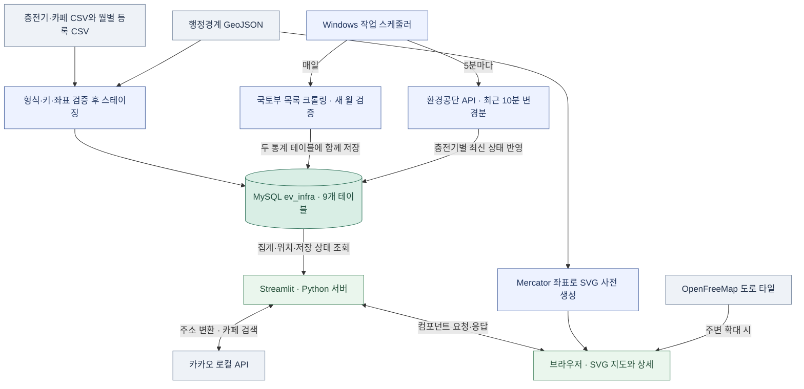
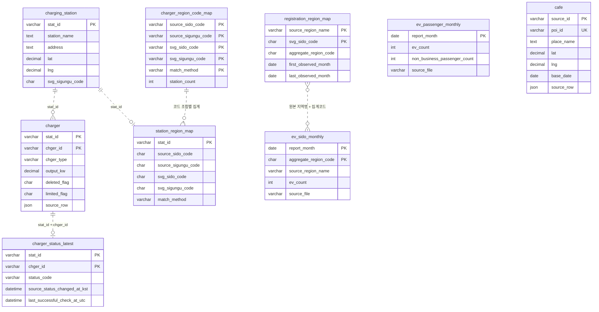

# 전기차 충전 인프라 지도

전기차 등록 규모에 비해 충전 설비가 얼마나 갖춰져 있는지 지역별로 비교하고, 실제로 이용할 충전소를 찾는 웹 서비스입니다. 전국 지도에서 공급 등급을 확인한 뒤 시군구로 들어가면 충전소 위치, 이용 가능한 충전기 수, 무료 주차 여부와 이용제한 사유를 볼 수 있습니다. 도로명주소 기준 가까운 충전소 5곳과 충전소 주변 카페도 조회할 수 있습니다.

| 충전소 | 충전기 | 지도 위치 매핑 | 월별 등록통계 |
| ---: | ---: | ---: | --- |
| 102,213곳 | 529,359기 | 101,355곳 | 2020년 1월~2026년 9월, 81개월 |

수치는 `ev_infra` 적재본 기준입니다. 충전기 전체 수에는 원본의 삭제·이용제한 행이 포함되며, 지도와 상세에는 각 화면의 집계 규칙을 적용합니다.

프로젝트를 만들며 겪은 문제와 변경 이유, 검증 결과는 [개발 회고](docs/development-retrospective.md)에 정리했습니다.

팀원이 자신의 PC에서 실행하려면 [Windows 재현 가이드](docs/windows-setup.md)의 저장소 복제, MySQL 복원, 스케줄러 등록 순서를 따라가면 됩니다.

**발표 순서**　[① 전체 흐름](#1-전체-워크플로) · [② 지표와 적재](#2-데이터와-지표) · [③ ERD](#3-mysql-erd) · [④ 웹 화면](#4-웹-서비스와-시연) · [⑤ 자동 갱신](#5-수집-자동화) · [⑥ 배포와 검증](#6-실행과-운영)

## 1. 전체 워크플로

원본은 먼저 MySQL에 검증해 적재합니다. 이후 월별 등록통계와 충전기 상태는 각각의 예약 작업이 갱신합니다. 웹은 저장된 값을 읽고, 입력 주소의 좌표 변환과 주변 카페 검색은 사용자가 요청한 시점에 카카오 로컬 API를 호출합니다.



[PPT 삽입용 워크플로 SVG](docs/diagrams/ev_workflow.svg)

<details>
<summary>워크플로 Mermaid 원본</summary>



</details>

## 2. 데이터와 지표

### 데이터 출처와 역할

| 출처 | 받는 형식 | 서비스에서 쓰는 값 |
| --- | --- | --- |
| 한국환경공단 | 충전기 CSV, `getChargerStatus` XML | 충전소 주소·좌표, 충전기 정격출력·이용제한, 상태 변경분. [공공데이터포털](https://www.data.go.kr/data/15076352/openapi.do) |
| 국토교통부 통계누리 | 자동차등록현황보고 XLSX | 전국 비사업용 승용차 등록 비중과 시도별 전기차 등록대수. [월별 자료](https://stat.molit.go.kr/portal/cate/statMetaView.do?hFormId=1244&hRsId=58) |
| 한국문화정보원 | 문화체육관광시설 인근 카페·디저트 시설 CSV | 위치와 원본 항목을 `cafe`에 보관. |
| 카카오 로컬 API | REST JSON | 도로명주소 좌표 후보, 충전소 반경 300m 이내 카페 최대 10곳. [카카오 로컬 REST API](https://developers.kakao.com/docs/ko/local/dev-guide) |
| V-World 가공 경계 · OpenFreeMap | GeoJSON · 벡터 타일 | 행정경계는 2023-07-29 배포본의 시도 17개·시군구 250개. 도로 타일은 충전소 주변 확대에서 사용. [GeoJSON 배포본](https://github.com/KnellBalm/kr-admin-geojson) · [OpenFreeMap](https://openfreemap.org/quick_start/) |

### 같은 등록자료에서 두 지표를 만드는 이유

| 지표 | 계산과 쓰임 |
| --- | --- |
| **전국 비사업용 승용차 중 전기 승용차 비중** | `전기 승용차 등록대수 ÷ 전체 연료 승용차 등록대수 × 100`. 분자와 분모 모두 관용·자가용에 해당하는 비사업용 범위입니다. 10번 시트에서 두 값을 추출하고, 분모를 01번 시트의 승용차 관용＋자가용 전국 합계와 대조합니다. 월별 추세에 쓸 값은 MySQL에 저장되어 있으며 화면 차트 연동은 후속 작업입니다. |
| **시도별 충전 인프라 공급 등급** | `이용제한 없는 충전기의 정격출력 합계 ÷ 최신 월 등록 전기차 대수`. 10번 시트의 전기 **차종 전체** 등록대수가 분모입니다. 분자는 지도에 매핑된 미삭제 충전기 중 이용제한이 없고 정격출력이 양수인 기기의 합입니다. |

두 지표의 등록자료에서 전기이륜차를 제외합니다. 공급 지표는 **등록차 한 대당 설비 용량(kW/대)**을 설명합니다. 충전소에 여러 기기가 있으면 각 기기의 출력을 더합니다. 등급은 매월 같은 수치 경계를 사용하므로 비교 대상 시도가 달라져도 같은 값에 같은 등급을 부여합니다.

| 등급 | 매우 부족 | 부족 | 보통 | 충분 | 여유 |
| --- | ---: | ---: | ---: | ---: | ---: |
| kW/대 | 1.3 미만 | 1.3 이상~3.0 미만 | 3.0 이상~5.0 미만 | 5.0 이상~8.0 미만 | 8.0 이상 |

1.3 kW는 EU AFIR의 경량 배터리 전기차당 공용 충전 출력에서 참고했고, 3.0·5.0·8.0은 프로젝트에서 정한 경계입니다. 등록대수가 없는 지역은 등급을 미집계로 표시합니다. 시군구는 등록대수 분모가 확보되기 전까지 미삭제 **충전기 수**를 색으로 표시합니다. [EU AFIR 제3조](https://eur-lex.europa.eu/legal-content/en/ALL/?uri=CELEX%3A32023R1804)

### 초기 적재와 좌표 검증

1. **원본 확인.** 충전기·카페 CSV와 전국·시도 등록 CSV, 매핑 CSV 3개를 검증합니다. UTF-8과 UTF-8 BOM은 `utf-8-sig`로 읽고, MySQL은 `utf8mb4`를 사용합니다. `chgerId=01`처럼 선행 0이 있는 코드와 ID는 문자형으로 저장합니다.
2. **충전소별 매핑.** `statId`의 좌표가 들어가는 시군구 폴리곤을 찾고 원본 `zcode`·`zscode`와 대조합니다. 경계를 격자로 나눠 후보를 좁힌 뒤 폴리곤 내부를 판정합니다. 코드와 좌표가 일치한 70,407곳, 원본 시도 안에서 좌표로 시군구를 확정한 30,948곳을 지도에 연결했습니다.
3. **검토 대상 분리.** 858곳은 원본 시군구와 좌표 불일치 294곳, 시도 불일치 279곳, 경계 밖 273곳, 경계 중첩 11곳, 원본 코드 충돌 1곳입니다. 지도용 시군구 코드를 비워 마커와 거리순 추천에서 제외했습니다. 이름·주소·ID 검색과 상세 조회는 가능합니다.
4. **스테이징과 전환.** 적재기가 원본 해시·헤더·키를 확인하고 InnoDB 스테이징 테이블을 만듭니다. 행 수와 충전소·충전기·상태 간 연결을 검증한 뒤 최종 테이블명으로 전환합니다. `charger.source_row`와 `cafe.source_row`에 원본 행을 JSON으로 보존합니다.

등록통계의 지역명은 지도 경계 코드와 별도로 매핑합니다. 예를 들어 전북의 집계코드 `52`는 SVG `45`로 연결합니다. 원본의 **전남광주** 합산 행은 SVG의 광주 `29`와 전남 `46`에 같은 공급 등급을 표시하고 전국 등록대수와 공용 출력 합계에는 한 번만 반영합니다. [매핑 및 적재 절차](db/import/README.md)

## 3. MySQL ERD

충전소 한 곳의 `stat_id` 아래 여러 충전기가 있습니다. `chger_id`는 충전소 안에서 쓰이는 식별자이므로 **`stat_id + chger_id`**가 충전기와 최신 상태의 공통 키입니다. ERD의 점선은 쿼리와 적재 검증에 쓰는 논리 연결입니다. 운영 적재본에 선언된 제약은 기본키와 카페의 유니크키이며, 물리 외래키는 0개입니다.



[PPT 삽입용 ERD SVG](docs/diagrams/ev_mysql_erd.svg) · [기존 스키마 정리 계획](docs/schema-plan.md)

<details>
<summary>ERD Mermaid 원본</summary>



</details>

| 테이블 | 행 수 | 저장 단위와 활용 |
| --- | ---: | --- |
| `charging_station` | 102,213 | 충전소 한 곳. 주소, 좌표, 운영기관, 운영시간, 지도용 코드. |
| `charger` | 529,359 | 충전기 한 대. 유형, 출력, 삭제·이용제한, 원본 JSON. |
| `charger_status_latest` | 529,359 | 충전기별 최신 상태 한 행. 상태 변경 시각(KST)과 API 관측 시각(UTC). |
| `station_region_map` | 102,213 | 충전소별 원본·지도 코드와 판정 결과. |
| `charger_region_code_map` | 620 | 코드 조합과 판정 방식별 **충전소 수**. |
| `registration_region_map` | 19 | 원본 등록지역과 SVG 시도 경계의 대응. |
| `ev_sido_monthly` | 1,374 | 기준월·원본 집계지역별 전기차 등록대수. |
| `ev_passenger_monthly` | 81 | 전국 기준월별 비사업용 전기 승용차와 전체 비사업용 승용차. |
| `cafe` | 113,440 | 공공데이터 카페·디저트 시설 한 곳. 상세 패널의 카페 추천에는 카카오 응답을 표시합니다. |

`charging_station.svg_sigungu_code`로 지역 마커를 조회합니다. 거리순 검색은 인덱스가 있는 `lat`, `lng`의 범위 조건으로 후보를 좁힙니다. 월별 통계는 기준월과 집계코드로 식별합니다. 여러 컬럼에 `PK`가 표시된 테이블은 해당 컬럼을 함께 키로 사용합니다.

## 4. 웹 서비스와 시연

### 화면에서 따라가는 순서

| 시연 동작 | 화면과 처리 |
| --- | --- |
| **전국 → 서울 → 관악구** | 전국은 공급 등급, 시도 안에서는 시군구별 충전기 수를 표시합니다. 마우스를 올리면 지역명과 수치를 확인할 수 있습니다. 시군구를 선택해도 인접 구의 색과 경계를 유지하며, 보이는 옆 구를 눌러 이동할 수 있습니다. |
| **마커 → 충전소 상세** | 현재 지도 중심과 배율로 오른쪽 패널을 엽니다. 지도 주소 라벨, 복사, 운영시간·운영기관, 사용 가능 대수, 주차 무료 여부와 이용제한 사유를 확인할 수 있습니다. 패널은 스크롤 또는 마우스 드래그로 읽습니다. |
| **숫자 마커 또는 충전소 주변 보기** | 해당 위치로 확대하고 간단한 도로 지도를 표시합니다. 숫자 마커는 묶음 내 충전소 목록도 엽니다. 확대 화면에서 지도 바탕을 누르면 그 지점이 같은 배율로 중앙에 옵니다. **한 단계 뒤로**로 시군구 범위에 복귀합니다. |
| **검색창에 `강` 또는 `낙성대로` 입력** | 지역 자동완성을 먼저 보여주고 한글 이름을 가나다순으로 정렬합니다. 동명 지역에는 시도를 붙여 구분합니다. 충전소명·도로명주소 부분 검색과 정확한 충전소 ID 검색도 지원합니다. |
| **빈 검색창 → 내 주변 충전소 찾기** | 입력한 도로명주소의 후보를 선택하면 기준 위치와 가까운 서로 다른 충전소 최대 5곳을 번호로 표시합니다. 기준점은 사용자가 선택한 주소입니다. |
| **즐겨찾기와 주변 카페** | 지역이나 충전소를 별명으로 저장해 왼쪽 목록에서 다시 열 수 있습니다. 상세에서 **주변 카페 찾기**를 누르면 이름·거리·주소를 확인할 수 있습니다. |

### 화면 뒤의 처리

- **지도 조작은 브라우저에서 처리합니다.** 빌드 스크립트가 WGS84 GeoJSON을 Mercator 좌표의 SVG 경로로 사전 변환합니다. 지도는 같은 경로를 유지하며 `viewBox`를 보간해 약 720ms 동안 확대합니다. 상세 패널이 열려 화면이 좁아질 때는 지도 양옆의 보이는 범위를 줄여 배율을 유지합니다. 키보드 선택과 모션 감소 설정을 지원합니다.
- **전국 데이터는 집계부터 내려보냅니다.** 처음에는 경계와 지역 집계를 보내고, 시군구에 들어갔을 때 해당 지역 충전소만 읽습니다. Streamlit은 초기 지도, 시군구 충전소, 단일 충전소 조회 결과에 300초 캐시를 적용합니다. 컴포넌트의 `requestId`로 같은 서버 요청의 중복 처리를 막습니다.
- **마커와 도로 지도의 비용을 나눕니다.** 브라우저는 화면상 25px 이내의 인접 마커를 묶고, 창 크기와 배율에 맞춰 묶음을 다시 계산합니다. 주변 확대 시 MapLibre GL로 OpenFreeMap 도로를 지연 로딩합니다. 확대·이동 중 같은 지도 인스턴스의 카메라를 SVG와 맞추며, 도로를 불러오는 동안에도 SVG 경계와 마커를 표시합니다.
- **거리 계산은 DB에서 합니다.** 지역 매핑이 확인되고 미삭제 충전기를 가진 충전소를 대상으로 좌표 범위를 5·25·100km 순으로 넓히고, 필요하면 전체 후보를 확인합니다. `ST_Distance_Sphere`로 시군구 경계를 넘어 직선거리순 상위 5곳을 고릅니다. 같은 거리에서는 충전소 ID로 순서를 정합니다.
- **카카오 API는 서버에서 호출합니다.** 주소 검색은 `/v2/local/search/address.json`으로 도로명과 좌표 후보를 받아 검증·중복 제거합니다. 키가 없으면 MySQL에 등록된 충전소 주소를 기준점 후보로 제공합니다. 카페는 `/v2/local/search/category.json`에 `CE7`, 경도·위도, 반경 300m, 거리순, 최대 10건을 전달합니다. 즐겨찾기는 현재 브라우저와 서비스 주소에 연결된 `localStorage`에 저장합니다. [카카오 로컬 REST API](https://developers.kakao.com/docs/ko/local/dev-guide)

상세는 한 충전소의 미삭제 충전기를 모두 조회합니다. 상태코드 **2만 사용 가능**으로 합산합니다. 코드는 0 알 수 없음, 1 통신 이상, 2 사용 가능, 3 충전 중, 4 운영 중지, 5 점검 중으로 표시합니다. 정격출력 기준 급속은 50kW 이상, 중속은 30 이상~50kW 미만, 완속은 0 초과~30kW 미만이며 값이 없거나 0 이하이면 출력 미확인입니다. 주차와 이용제한은 각각 원본 `parkingFree`, `limitYn`, `limitDetail`을 표시합니다. 상태 변경 시각과 API 관측 시각은 초 단위로 구분해 보여줍니다.

## 5. 수집 자동화

### 월별 등록통계 · 하루 한 번

`jobs/crawl_registrations.py`는 통계누리의 HTML 목록에서 자동차 월별 엑셀 첨부를 찾습니다. 링크의 표시 파일명과 서버 저장 파일명을 함께 읽어 다운로드 URL을 만들고, 검증된 XLSX는 SHA-256을 붙여 보관합니다. 크롤링으로 공개 여부와 첨부파일을 찾고, `openpyxl`로 통계 값을 추출합니다.

- **비교 모드**는 다운로드 원본의 전국 2개 항목과 지역별 등록대수를 DB와 대조합니다. 2026년 7~9월 검증에서는 54개 비교 항목이 일치했습니다. 결과는 `jobs/results/mysql_comparison.csv`에 남습니다.
- **`--sync-new`**는 DB의 최신 기준월 이후 자료만 대상으로 합니다. 새 월이 없으면 정상 종료합니다. 대상 월의 연속성, 엑셀 기준월과 시트 구성, 지역합계, 01·10번 시트 간 비사업용 승용차 합계 및 기존 지역코드 구성을 검사합니다.
- 통과한 새 월은 전국·시도 두 테이블에 한 트랜잭션으로 적재합니다. 적재 뒤 DB를 재조회해 `jobs/results/mysql_sync_verification.csv`로 확인합니다. 이 작업은 공개 목록을 읽으므로 수집용 API 키 없이 실행합니다. [등록통계 크롤러 상세](docs/registration-crawler.md)

### 충전기 상태 · 5분마다

`jobs/poll_charger_status.py`는 `zcode`를 생략해 전국의 **최근 10분 변경분**을 읽습니다. `pageNo`를 올리며 순회하고, 응답에 페이지 정보가 있으면 `totalCount`를 검증합니다. `items`만 있으면 빈 목록까지 확인하며 같은 페이지가 반복되면 실패로 기록합니다. 요청당 최대 9,999행을 지정하며, 실행당 20페이지와 한국 시간 기준 기본 900회/일의 **수집기 내부 호출 예산**을 적용합니다.

1. 5분마다 조회해 이전 요청 구간과 약 5분을 겹칩니다. 같은 충전기가 두 번 내려오면 `statId + chgerId`별 상태 변경 시각을 비교합니다.
2. 형식이 맞는 행의 최신 변경을 임시 테이블에 담고, 기존 `charger`와 키가 일치할 때만 MySQL에 반영합니다. 최신 변경만 삽입·갱신하고 이전 응답이나 동일 시각의 상충 상태로 기존 값을 덮어쓰지 않습니다. 초기 CSV와 상태가 일치하고 API 관측값이 비어 있으면 최초 관측 시각을 채웁니다.
3. 마지막 성공 시각과 호출 예산은 `.local/charger_status/sync.json`, 실행 결과는 같은 경로의 `sync.log`에 남깁니다. 상세의 **저장 상태 다시 읽기**는 MySQL을 재조회합니다. 최근 성공이 10분을 넘거나 기록된 수집 공백이 있으면 화면에서 확인할 수 있습니다.

페이지 간 건수가 바뀌면 로그에 남기고 다음 실행의 겹치는 구간에서 재조회합니다. 10분을 넘긴 수집 중단이나 초기 적재 이후의 장기 공백을 복구할 때는 별도의 상태 스냅샷 확인이 필요합니다. 이 작업은 기존 충전기의 **상태**를 갱신하며, 신규 충전소·충전기나 주소·정격출력 변경은 원본 데이터 갱신에 해당합니다. [상태 수집기 상세](docs/charger-status-sync.md)

### Windows 작업 스케줄러 등록

두 작업은 배포 PC의 Windows 작업 스케줄러에 등록한 구성입니다. 아래 값으로 다시 설정할 수 있습니다. **프로그램**에는 의존성이 설치된 Python의 절대경로를 지정합니다. Conda `project01`을 사용한다면 해당 환경의 `python.exe`를 직접 실행하므로 스케줄러에서 별도로 `conda activate`할 필요가 없습니다.

| 작업 만들기 항목 | 월별 등록통계 수집 | 충전기 상태 수집 |
| --- | --- | --- |
| 일반 | 실행 계정 지정, 사용자 로그온 여부와 관계없이 실행 | 동일 |
| 트리거 | 매일 1회, 배포 PC의 지정 시각 | 한 번 시작한 뒤 **5분마다**, 기간 **무기한** |
| 프로그램/스크립트 | 예시 `C:\Users\Admin\anaconda3\envs\project01\python.exe` | 동일 |
| 인수 추가 | `"C:\Users\Admin\myprojects\전기차\ev-infra-map\jobs\crawl_registrations.py" --sync-new` | `-m jobs.poll_charger_status` |
| 시작 위치 | `C:\Users\Admin\myprojects\전기차\ev-infra-map` | 동일. 모듈과 `services` 패키지를 찾는 프로젝트 루트. |
| 설정 | 기존 실행 중이면 새 인스턴스를 시작하지 않음. 놓친 예약은 가능한 한 빨리 시작. | 기존 실행 중이면 새 인스턴스를 시작하지 않음. |
| 성공 확인 | 마지막 실행 결과 `0x0`. 신규 월이 있으면 DB 기준월과 검증 CSV를 확인. | 마지막 실행 결과 `0x0`, `sync.log`의 수집 완료와 `sync.json`의 최근 성공 시각 확인. |

1. 실행 계정에서 MySQL 로그인 경로를 만들고 DB 연결을 확인합니다. 상태 수집 작업 계정에만 `EV_CHARGER_SERVICE_KEY`를 설정합니다. 웹 계정과 수집 계정이 다르면 웹에서 상태 파일을 읽을 수 있어야 합니다.
2. **작업 만들기 → 일반 → 트리거 → 동작 → 설정** 순서로 값을 저장합니다. 인수 속 스크립트 경로는 큰따옴표로 감싸고, **시작 위치**에는 따옴표 없이 프로젝트 루트를 입력합니다.
3. 첫 운영 확인은 해당 계정으로 수동 실행한 뒤 작업 스케줄러의 마지막 실행 결과와 결과 파일을 함께 확인합니다. 상태 수집 1회는 실제 API 호출 예산을 사용하고, 새 월 수집은 검증을 통과하면 DB에 반영합니다.

## 6. 실행과 운영

### 배포 PC에서 실행

Windows, Python 3.10 이상, MySQL 8.0 클라이언트와 서버, 초기 적재가 완료된 `ev_infra`가 필요합니다. Python 의존성은 Streamlit, pandas, requests, openpyxl이며 버전은 `requirements.txt`에 있습니다. 아래 명령은 저장소 루트의 PowerShell에서 실행합니다.

```powershell
python -m pip install -r requirements.txt

$mysqlBin = 'C:\Program Files\MySQL\MySQL Server 8.0\bin'
& (Join-Path $mysqlBin 'mysql_config_editor.exe') set --login-path=evlocal --host=127.0.0.1 --port=3306 --user=YOUR_DB_USER --password
& (Join-Path $mysqlBin 'mysql.exe') --login-path=evlocal --database=ev_infra -e "SELECT MAX(report_month) FROM ev_sido_monthly;"

python -m streamlit run app.py
```

| 설정 | 적용 위치 |
| --- | --- |
| `EV_MYSQL_EXE`, `EV_MYSQL_LOGIN_PATH`, `EV_MYSQL_DATABASE` | 웹과 충전기 수집기. 기본값은 Windows MySQL 8.0 실행 파일, `evlocal`, `ev_infra`. |
| 크롤러 `--mysql`, `--login-path`, `--database` | 등록통계 크롤러의 기본 DB 연결을 변경할 때 작업 인수에 지정. |
| `EV_CHARGER_SERVICE_KEY` | 충전기 수집 작업을 실행하는 계정의 환경변수. |
| `EV_CHARGER_SYNC_STATE` | 기본 상태 파일을 옮길 때 웹과 상태 수집기에 같은 절대경로 지정. |
| `KAKAO_REST_API_KEY` | 웹 프로세스 환경변수 또는 `.streamlit/secrets.toml`. [설정 예시](.streamlit/secrets.toml.example) |

DB 권한은 웹 조회, 등록통계 조회·삽입, 충전기 상태 조회·삽입·갱신 및 임시 테이블 생성으로 작업별 분리할 수 있습니다. 키와 MySQL 인증은 서버·작업 계정에서 관리합니다. 새 DB의 초기 적재에는 원본 CSV 4개와 검증된 매핑 CSV 3개, `snapshot_hashes.json`이 필요합니다. 아래 검증이 끝난 뒤 [초기 적재 절차](db/import/README.md)에 따라 실제 적재를 진행합니다.

```powershell
python .\db\import\load_mysql.py --source-dir 'C:\Users\Admin\myprojects\전기차\db' --dry-run
python -m scripts.build_map_assets
```

### 저장소 구조

| 경로 | 역할 |
| --- | --- |
| `app.py`, `services/` | Streamlit 요청 처리, MySQL 조회, 좌표 투영, 외부 API 연동. |
| `components/` | `index.html`, `map_view.js`·CSS, Streamlit 브리지, MapLibre 도로 지도. |
| `jobs/` | 등록통계 크롤러, 충전기 상태 수집기. |
| `db/import/` | 지역 매핑 생성과 초기 적재·검증. |
| `scripts/`, `assets/`, `data/geo/` | 지도 빌드 코드, 생성된 SVG·JSON, 경계 원본. |
| `data/sample/`, `data/demo/` | 실제 적재본에서 추출한 표본과 가상 시연 자료. 실제 웹 지도는 MySQL을 읽습니다. [실데이터 표본](data/sample/README.md) |
| `tests/`, `docs/` | 자동 검사, 운영 문서와 발표용 SVG. |

Git에는 소스·문서·공개 가능한 표본을 관리합니다. 원본 대용량 CSV, 로컬 백업과 적재 패키지, 작업 로그·비교 결과, API 키는 각 PC에서 관리합니다. `.local/`, `jobs/results/`, `.streamlit/secrets.toml`은 Git 제외 경로입니다.

### 발표 직전 점검

```powershell
python -m unittest discover -s tests
node --test tests/test_nearby.cjs
python .\jobs\crawl_registrations.py --months 2026-07 2026-08 2026-09
```

브라우저에서는 **서울 → 관악구 → 숫자 마커 → 개별 상세 → 한 단계 뒤로** 순서로 확대와 배율 유지, 충전기별 상태와 이용조건을 확인합니다. 이어서 빈 검색창에서 내 주변 찾기를 열어 5곳의 거리순 표시와 즐겨찾기 복원을 확인합니다. 운영 상태는 웹의 표시 시각, 스케줄러 실행 결과, DB 또는 수집 로그를 함께 대조합니다.

시연에서 충전소를 바로 열 때는 **낙성대동주민센터** 또는 `ME174013`으로 검색합니다. 내 주변 찾기에는 **서울특별시 관악구 낙성대로4가길 5**를 입력할 수 있습니다.

발표에서 데이터 범위를 설명할 때는 **시도 공급 등급은 정격출력 기준**, **개별 충전기 사용 가능 여부는 최신 저장 상태 기준**, **월별 전기 승용차 비중은 등록대수 기준**으로 구분하면 됩니다. 후속 작업 범위는 월별 추세 차트, 좌표 검토 대상 정리, 독립 DDL과 마이그레이션 구성입니다.
