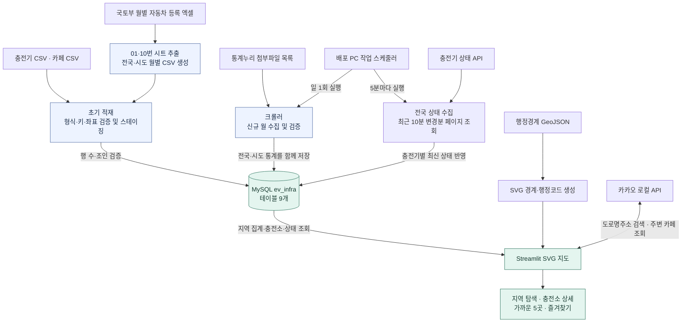
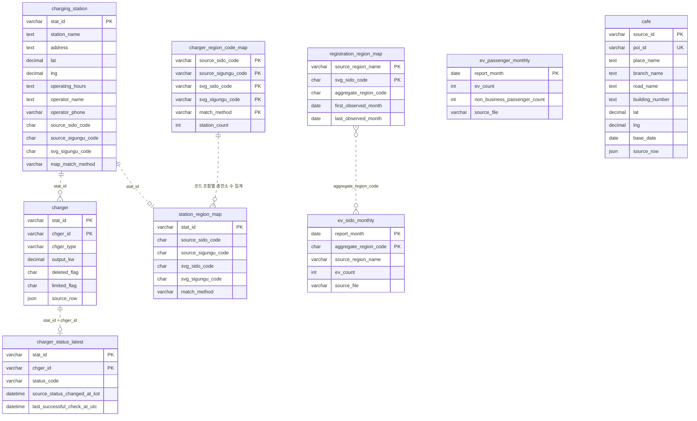

# 전기차 충전 인프라 지도

전기차 등록 규모와 충전 인프라를 지역별로 비교하고, 도로명주소 주변에서 가까운 충전소를 찾는 Streamlit 웹앱입니다. 지도는 전국 → 시도 → 시군구 → 충전소 순서로 탐색합니다. 전기이륜차는 집계 대상에서 제외합니다.

## 전체 워크플로

배포 PC의 Windows 작업 스케줄러에 월별 등록통계 수집과 전국 충전기 상태 수집을 등록했습니다. 실제 수집 성공 여부는 각 작업의 실행 결과와 로그에서 확인합니다.

### 수집과 검증

1. **초기 적재.** 충전기·카페 원본 CSV와 자동차 등록통계 CSV를 읽고 UTF-8/BOM, 키 중복, 행 수를 검사합니다. 충전기는 `stat_id + chger_id`로 구분하고 충전소는 `stat_id`로 묶습니다. 스테이징 테이블에서 행 수와 충전소·충전기·상태의 연결을 확인한 뒤 서비스 테이블로 전환합니다.
2. **지도 매핑.** 충전소의 원본 지역코드와 좌표를 기존 SVG 행정경계에 대조해 매핑합니다. 경계 밖에 있거나 코드와 좌표가 어긋나는 등 검토가 필요한 **858곳**은 주소를 추가로 비교하고, 지도용 시군구 코드를 비워 두었습니다. 사용 중인 경계는 2023년 V-World 원본을 가공한 배포본입니다. [GeoJSON 배포본](https://github.com/KnellBalm/kr-admin-geojson)
3. **월별 통계 갱신.** 크롤러가 통계누리 공개 목록에서 자동차 엑셀을 찾아 받습니다. `--sync-new` 모드는 MySQL 최신 월 이후 자료의 기준월, 01·10번 시트 합계, 지역코드를 검증하고 두 통계 테이블에 함께 저장합니다. 2026년 7~9월 다운로드 원본과 적재본의 비교 항목 **54개가 모두 일치**했습니다. DB가 설치된 Windows PC에 하루 한 번 실행하는 작업을 등록했습니다. [국토교통부 월별 통계 목록](https://stat.molit.go.kr/portal/cate/statMetaView.do?hFormId=1244&hRsId=58)

### 현재 화면과 서비스 연동 범위

| 기능 | 확인한 상태 |
|---|---|
| 지도·검색·즐겨찾기 | 지도 데이터는 MySQL에서 읽고 브라우저에서 SVG 확대와 지도 조작을 처리합니다. 충전소 검색, 상세 및 직선거리 기반 최근접 5곳은 서버에서 조회합니다. 즐겨찾기는 브라우저 `localStorage`에 저장합니다. |
| 주소·주변 카페 조회 | 키가 설정되면 도로명주소를 좌표로 변환하고, 충전소 상세에서 반경 300m 이내 카페를 거리순으로 최대 10곳 표시합니다. [카카오 로컬 API 문서](https://developers.kakao.com/docs/ko/local/dev-guide) |
| 실데이터 지도·등록 추세 | MySQL 초기 적재와 크롤러 검증을 완료했습니다. Streamlit 지도에 MySQL을 연결했습니다. 월별 추세 차트는 연동 단계입니다. |
| 충전기 상태 | 배포 PC에 5분마다 실행하는 작업을 등록했습니다. 최근 10분 전국 변경분을 페이지별로 읽고, 충전기별 최신 상태를 저장합니다. 상세 화면은 DB에 저장된 상태와 수집 시각을 읽습니다. [상태 수집 설정](charger-status-sync.md) |
| 이용제한·정격출력 | DB에는 원본 삭제 여부, 이용제한 여부, 충전기 유형 및 정격출력을 보관합니다. 이용제한 없는 충전소 목록과 급속·완속 분류는 서비스 조회 규칙으로 적용합니다. |

전국 지도는 `공용 충전기 정격출력 합계 ÷ 등록 전기차 대수`를 공급 지표로 사용합니다. 1.3·3.0·5.0·8.0 kW/대를 고정 경계로 매우 부족·부족·보통·충분·여유를 표시합니다. 시군구 지도는 실제 충전기 수로 색을 표시합니다. 전국 월별 등록 비중은 **비사업용 승용차** 기준으로 관용과 자가용을 포함하고, 시도별 전기차 등록대수는 **차종 전체** 기준입니다. 시군구 공급 등급을 계산하려면 시군구별 전기차 등록대수가 별도로 필요합니다.

## 현재 MySQL ERD

실제 `ev_infra`의 9개 테이블과 주요 컬럼입니다. `PK`와 `UK`는 DB에 생성된 제약입니다. 점선은 코드와 조회에서 사용하는 **논리 연결**이며, 현재 DB에는 물리 FK가 없습니다. 복합 PK는 한 테이블 안에서 `PK`가 붙은 컬럼을 함께 사용합니다.

`charger_region_code_map`은 충전소별 매핑을 코드 조합과 검증 방식별로 집계한 표입니다. 지도에 마커를 배치할 때는 `station_region_map`의 충전소별 결과를 사용합니다. `전남광주`처럼 원본의 집계코드 하나가 SVG의 두 시도에 연결될 수 있으므로, 전국 합계에서는 해당 집계 행을 한 번만 계산합니다. `cafe`는 공공데이터에서 별도로 적재한 위치 테이블입니다. 상세 패널의 카카오 카페 검색 결과는 화면에 표시합니다.

| 테이블 | 행 수 | 저장 단위 |
|---|---:|---|
| `charging_station` | 102,213 | 충전소 1곳 |
| `charger` | 529,359 | 충전기 1대 |
| `charger_status_latest` | 529,359 | 충전기별 최신 상태 1행 |
| `station_region_map` | 102,213 | 충전소별 행정구역 검증 결과 |
| `charger_region_code_map` | 620 | 원본·SVG 코드 조합 및 매핑 방식별 집계 |
| `registration_region_map` | 19 | 등록통계 지역과 지도 시도 간 매핑 |
| `ev_passenger_monthly` | 81 | 전국 월별 비사업용 승용차 집계 |
| `ev_sido_monthly` | 1,374 | 기준월·집계 지역별 전기차 등록대수 |
| `cafe` | 113,440 | 카페·디저트 시설 1곳 |

등록통계의 기준월 범위는 **2020년 1월~2026년 9월**입니다. 위 행 수는 발표 문서 작성 시 `ev_infra`에서 조회한 값입니다.
